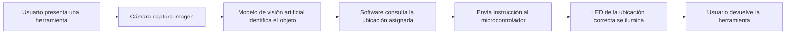

# Key Week — Sistema inteligente de identificación y ubicación de herramientas

> **Documento de referencia del proyecto**  
> **Espacio de aplicación:** Laboratorios y taller SPARK de Key Institute  
> **Duración del reto:** Cuatro días, de lunes a jueves  
> **Estado:** Definición del reto y planificación inicial

## 1. Resumen ejecutivo

Durante la **Key Week**, los equipos deben desarrollar un **prototipo funcional** que permita identificar herramientas, equipos o materiales mediante **visión artificial e inteligencia artificial (IA)** y mostrar físicamente dónde corresponde guardarlos.

El sistema utilizará una **cámara** para reconocer uno de los objetos seleccionados; luego, un **software** interpretará el resultado, lo comunicará a un **microcontrolador** y activará una **señal luminosa** (como un LED o una barra LED) en la posición asignada dentro del taller.

El reto consiste en implementar esta solución para **nueve (9) herramientas o elementos** elegidos por cada equipo. El resultado debe pasar de una idea a un prototipo demostrable durante los cuatro días del evento.

## 2. Problemática

En los laboratorios y talleres, algunas herramientas y materiales no se devuelven a sus posiciones designadas. Esto dificulta que otras personas los encuentren cuando necesitan utilizarlos y genera pérdida de tiempo y desorganización.

### Pregunta central del reto

> **¿Cómo podemos hacer que el taller sepa dónde pertenece cada herramienta?**

La solución debe facilitar el proceso de devolución de herramientas y ayudar al usuario a reconocer **qué objeto tiene enfrente** y **en qué ubicación debe colocarlo**.

## 3. Objetivo general

Diseñar, construir y demostrar un sistema automatizado que **reconozca nueve herramientas mediante visión artificial y señale visualmente la ubicación de almacenamiento correspondiente a cada una**.

### Objetivos específicos

1. **Reconocer:** identificar el objeto colocado frente a una cámara utilizando un modelo de visión artificial/IA.
2. **Procesar:** determinar cuál es la ubicación asignada al objeto reconocido.
3. **Comunicar:** transmitir esa decisión desde el software hacia el dispositivo de control electrónico.
4. **Señalizar:** encender una luz o indicador visual en el lugar donde debe guardarse la herramienta.

Estos cuatro objetivos —**reconocer, procesar, comunicar y señalizar**— fueron indicados expresamente como los componentes esenciales del proyecto.

## 4. Alcance y requisitos del prototipo

### 4.1. Requisitos indicados durante la explicación

- Seleccionar **exactamente nueve (9) herramientas, equipos, aparatos o materiales** del entorno SPARK.
- Definir una **ubicación física de almacenamiento** para cada elemento, usando los estantes u otras posiciones apropiadas del laboratorio/taller.
- Utilizar una **cámara** para observar los objetos y un componente de **visión artificial con IA** para identificarlos.
- Programar la lógica que relacione cada identificación con su lugar asignado.
- Enviar una instrucción a un **microcontrolador** o dispositivo electrónico para realizar la señalización.
- **Iluminar la ubicación correcta** mediante un LED, una barra de LEDs u otra solución luminosa.
- Integrar los componentes en un **flujo automático**, sin requerir que una persona seleccione manualmente la herramienta reconocida.
- Construir un **prototipo funcional** y demostrarlo al final de la semana.

### 4.2. Libertades de diseño

El equipo puede decidir:

- Cuáles serán las nueve herramientas; pueden ser del mismo tipo o de categorías distintas.
- Qué microcontrolador o plataforma electrónica utilizar (se mencionaron **ESP32, Arduino y Raspberry Pi** como posibilidades).
- Cómo se colocarán y distribuirán los indicadores luminosos.
- Qué software, modelo de IA y arquitectura de comunicación emplear.
- Cómo presentar físicamente el prototipo e incorporar elementos creativos o manufactura mediante impresión 3D.

**Importante:** la simulación presentada por los docentes fue un **ejemplo orientativo**, no un diseño obligatorio. El ejemplo mostraba seis objetos, pero el requisito del reto es trabajar con **nueve**.

## 5. Funcionamiento esperado

### Flujo general

### Ejemplo de uso

1. Una persona desea devolver un **multímetro**.
2. Coloca el multímetro frente a la **cámara** del prototipo.
3. El sistema lo identifica como **«multímetro»**.
4. El programa determina que su lugar asignado es, por ejemplo, **«Estante A — Posición 3»**.
5. El microcontrolador recibe una instrucción para activar el **LED asociado a esa posición**.
6. La luz guía a la persona hacia el lugar correcto de almacenamiento.

> **Nota:** el multímetro, el nombre del estante y la posición ilustran un posible flujo; no constituyen una lista ni distribución definitiva de herramientas.

## 6. Componentes del sistema

| Componente | Función | Estado en el reto |
|---|---|---|
| Nueve herramientas o materiales | Objetos que el sistema debe reconocer | Obligatorio; selección libre |
| Cámara | Capturar imágenes de los objetos | Obligatorio |
| Modelo de visión artificial/IA | Identificar cuál herramienta se presenta | Obligatorio |
| Software de procesamiento | Asociar la herramienta con su posición y generar una instrucción | Obligatorio |
| Microcontrolador o plataforma electrónica | Recibir la instrucción y activar la salida correspondiente | Componente recomendado en la explicación y parte del flujo esperado |
| LEDs o iluminación equivalente | Indicar visualmente la posición correcta | Obligatorio como función de señalización |
| Cableado y conexiones | Integrar los componentes físicos | Necesario según la solución |
| Estantes o estructura de almacenamiento | Alojar las ubicaciones señalizadas | Necesario para la demostración |
| Piezas impresas en 3D | Soportes, carcasas o acabados | Opcional |

### Materiales básicos anunciados

Se indicó que los organizadores proporcionarían **un microcontrolador, LEDs y cables** para las conexiones. No se especificaron en la transcripción el modelo exacto, las cantidades ni el resto del inventario disponible.

## 7. Cronograma de Key Week

| Día | Enfoque | Trabajo esperado |
|---|---|---|
| **Lunes — Día 1** | Visión artificial e IA | Seleccionar las nueve herramientas y comenzar el desarrollo del modelo de reconocimiento de objetos. |
| **Martes — Día 2** | Electrónica, microcontroladores e impresión 3D | Desarrollar la señalización física, las conexiones y la comunicación con el sistema de reconocimiento; explorar impresión 3D. |
| **Miércoles — Día 3** | Integración y pruebas | Conectar las partes de IA y electrónica, terminar el prototipo, realizar acabados y comprobar su funcionamiento. |
| **Jueves — Día 4** | Demostración y pitch | Presentar el sistema, demostrar su funcionamiento, responder preguntas y participar en la evaluación final. |

## 8. Entregable final

El entregable esencial es un **sistema funcional que reconozca las herramientas seleccionadas y señale el lugar donde deben guardarse**.

La presentación del jueves debe incluir:

- Una explicación breve de **qué problema se resuelve** y por qué la solución es útil.
- Una presentación o **pitch** que explique el valor de la propuesta.
- Una **demostración real** de reconocimiento, comunicación y señalización.
- Respuestas a las preguntas del jurado o de los evaluadores.

### Tiempo indicado para la presentación

- **10 minutos** para el pitch y la demostración, con **7 minutos destinados a mostrar el funcionamiento**.
- **5 minutos adicionales** para preguntas.

## 9. Criterios de evaluación mencionados

| Criterio | Qué se evaluará |
|---|---|
| **Funcionalidad del prototipo** | Que el sistema identifique las herramientas y encienda el indicador correspondiente a su lugar de almacenamiento. |
| **Flujo automático** | Que cámara, procesamiento y dispositivo electrónico funcionen conectados como una secuencia automatizada. |
| **Precisión de reconocimiento** | Que el sistema identifique correctamente las nueve herramientas durante las pruebas. |
| **Creatividad e innovación** | Que el equipo aporte una solución propia y aproveche la tecnología más allá de los materiales básicos suministrados. |

**Aclaración:** durante la exposición se mencionó un **96 % de detección** como parte de un ejemplo. No debe interpretarse como una meta oficial o umbral mínimo sin consultar la rúbrica completa. Tampoco aparecen en la transcripción ponderaciones numéricas de los criterios.

## 10. Plan técnico sugerido para el equipo

> **Esta sección contiene recomendaciones de implementación, no requisitos adicionales establecidos por los docentes.**

### 10.1. Selección y registro

Elaborar una tabla con los nueve objetos y su ubicación asignada:

| ID | Herramienta | Ubicación física | Indicador |
|---|---|---|---|
| 01 | Por definir | Por definir | LED 1 |
| 02 | Por definir | Por definir | LED 2 |
| 03 | Por definir | Por definir | LED 3 |
| 04 | Por definir | Por definir | LED 4 |
| 05 | Por definir | Por definir | LED 5 |
| 06 | Por definir | Por definir | LED 6 |
| 07 | Por definir | Por definir | LED 7 |
| 08 | Por definir | Por definir | LED 8 |
| 09 | Por definir | Por definir | LED 9 |

### 10.2. Visión artificial

- Fotografiar cada herramienta desde varios ángulos y con distintas condiciones de iluminación.
- Organizar las imágenes por clase y entrenar o adaptar un modelo de reconocimiento de objetos.
- Realizar pruebas con imágenes no utilizadas durante la preparación del modelo.
- Prever una respuesta **«objeto no reconocido»** cuando la confianza sea insuficiente, para evitar encender una ubicación incorrecta.

### 10.3. Integración electrónica

- Mantener una relación fija entre **clase reconocida → ubicación → LED**.
- Definir cómo se comunicará el software con el microcontrolador: por ejemplo, **USB/serial o Wi-Fi**, según los componentes disponibles.
- Probar cada LED individualmente antes de integrar el reconocimiento de imágenes.
- Encender el indicador únicamente cuando exista una identificación válida.

### 10.4. Pruebas antes de la demostración

- Verificar que se pueden identificar las **nueve clases**.
- Comprobar que cada reconocimiento enciende **el LED correcto**.
- Probar varias herramientas en secuencia.
- Evaluar casos de iluminación variable y objetos que se parecen.
- Preparar un procedimiento de recuperación cuando se pierde la conexión o el modelo no reconoce un objeto.

## 11. Lista de verificación para la entrega

- [ ] Elegimos las nueve herramientas o materiales.
- [ ] Definimos y señalizamos sus nueve ubicaciones.
- [ ] La cámara obtiene imágenes utilizables.
- [ ] El modelo reconoce los nueve objetos.
- [ ] El software relaciona cada objeto con su posición.
- [ ] La instrucción llega al sistema electrónico.
- [ ] Cada LED se activa en la posición adecuada.
- [ ] El flujo completo funciona automáticamente.
- [ ] Probamos todos los objetos en una demostración continua.
- [ ] Tenemos listo el pitch y la demostración del jueves.

## 12. Puntos pendientes de confirmar con los organizadores

La transcripción no precisa:

1. **Rúbrica completa**, puntajes o ponderaciones por criterio.
2. **Cantidad y modelo** de las cámaras, microcontroladores, LEDs y demás materiales disponibles.
3. Si habrá condiciones de prueba estandarizadas o un requisito mínimo de precisión.
4. Si el equipo debe trabajar exclusivamente con los estantes existentes o puede construir una maqueta funcional.
5. **Premios exactos:** se mencionan montos y formatos de manera inconsistente, por lo que es preferible confirmarlos antes de documentarlos como oficiales.

---

## 13. Idea fuerza del proyecto

**El objetivo no es únicamente que una IA reconozca objetos: debe ver, decidir y actuar.** La innovación del reto está en integrar la identificación visual con una acción física clara para el usuario, ayudando a mantener el taller organizado.

### Fuente

Documento elaborado a partir de la **transcripción de la explicación del reto de Key Week** proporcionada por el usuario. Los requisitos y el cronograma se derivan de esa explicación; la sección 10 contiene recomendaciones técnicas propias para facilitar la ejecución.
