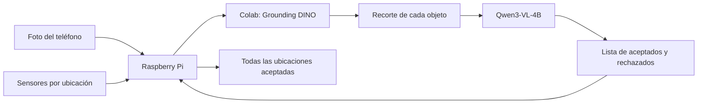

# Kiwi — identificar y devolver varias herramientas

Prototipo de **Key Week / ToolLighthouse**. Una persona fotografía varias herramientas, **Grounding DINO** localiza los objetos y **Qwen3-VL-4B-Instruct** reconoce cada recorte en Google Colab. La Raspberry Pi enciende todas las ubicaciones aceptadas y verifica sus devoluciones simultáneamente con sensores.

[](https://colab.research.google.com/github/fcanas574/kiwi/blob/main/Kiwi_EmbeddingGemma2_Colab.ipynb)



## Cómo funciona

1. DINO devuelve cuadros para las herramientas descritas en inglés. Se eliminan cuadros muy similares; se procesan hasta 12 recortes por imagen.
2. Qwen clasifica cada recorte. Rechaza `otros` y resultados ambiguos; sus criterios iniciales son puntuación ≥ 0,90 y margen ≥ 0,50. Las puntuaciones de DINO y Qwen se mantienen separadas y no son probabilidades calibradas.
3. La pantalla muestra la foto con cuadros y todos los objetos. Los aceptados encienden los LEDs de sus ubicaciones; los rechazados permanecen visibles para revisión.
4. Cada ubicación pendiente está azul; al detectar la devolución cambia a verde. Las demás siguen pendientes. La operación termina cuando todas estén confirmadas y no quede una ubicación equivocada marcada.
5. **Corregir** en un objeto guarda únicamente su recorte y la etiqueta real para ampliar el dataset.

**Límite del hardware:** un sensor de presencia verifica que una ubicación se ocupó, no la identidad ni la cantidad de herramientas depositadas. Varios objetos de una categoría comparten una ubicación y un LED. Una posición que ya estaba ocupada debe liberarse antes de contar una nueva devolución. Sin sensores, el sistema guía pero no declara una devolución verificada.

## Escaneo continuo desde el celular

Para el stand, abre la página de Kiwi desde el celular dedicado y la misma red Wi‑Fi que la Raspberry. Configura el endpoint REST de Colab, `KIWI_API_KEY` y un código diferente en `KIWI_SCAN_PAIRING_KEY`; prepara la IP reservada y el certificado HTTPS siguiendo [la guía local para el teléfono](docs/local-phone-setup.md). Cada teléfono necesita confiar en esa CA antes de que el navegador pueda usar su cámara. No pongas ninguna clave en el QR ni en la URL.

En la página, empareja el teléfono una vez y pulsa **Iniciar escaneo**. **Pausar escaneo** conserva las guías; **Cancelar devoluciones** pausa la captura y cancela ese ciclo. Si la página pierde la conexión, vuelve a abrirla, empareja de nuevo si lo solicita y pulsa **Iniciar escaneo** para continuar con una generación nueva. Al cambiar de teléfono, prepara primero su confianza HTTPS; el teléfono anterior debe pausar o liberar la sesión.

Una categoría confirmada permanece suprimida mientras siga visible. Se rearma tras tres detecciones válidas sin esa categoría; una pausa, un error de Colab o cuadros que no llegaron no cuentan como ausencia. La captura solicita como máximo un cuadro por segundo y limita el lado mayor a 960 píxeles; la frecuencia efectiva depende del navegador, la red y Colab. Para probar en CPU lenta, deja un `recognizer.timeout_seconds` amplio y ajusta `scan.max_gap_seconds` solo después de medir; esto no implica que el escaneo sea en tiempo real.

El flujo manual de **Tomar foto**, **Subir foto** y reconocimiento individual sigue disponible. El escaneo continuo requiere el endpoint REST de Colab (`/detect` y `/classify`); Gradio conserva el modo manual.

El flujo principal siempre es DINO → Qwen. EmbeddingGemma 2 puede añadirse como verificación por recorte mediante `VLM_CHECK_WITH_REFERENCES=True`; queda desactivado por defecto.

## Preparar Colab

1. Abrir el notebook con el botón anterior y guardar una copia en Drive.
2. Seleccionar **GPU T4** si está disponible. CPU también funciona: Qwen se carga en NF4 de 4 bits y usa recortes de menor resolución; sus resultados pueden diferir de GPU.
3. Ejecutar las secciones **1–5c**: dependencias, categorías, preparación, Qwen y DINO. No hace falta `references.zip` para el flujo principal.
4. Para ver resultados desde Colab/celular, ejecutar **6 (Gradio)** e introducir la contraseña de la sesión. Devuelve imagen anotada, galería y JSON.
5. Para conectar la Pi, crear los secretos `NGROK_AUTHTOKEN` y `KIWI_API_KEY` (16 caracteres o más), ejecutar **6b** y copiar el endpoint `/predict`.

Si activas la verificación adicional con EmbeddingGemma, subir [`references.zip`](dataset_prepared/references.zip) a **Mi unidad/Kiwi/references.zip**, autorizar Drive y volver a ejecutar desde 2. Los umbrales y la precisión deben evaluarse con fotos nuevas.

### Gradio y ngrok

- **Gradio:** página de fotografías y API `/identify`; devuelve tres salidas, y el JSON de objetos es la tercera.
- **ngrok:** publica la API REST de FastAPI para la Pi: `POST /predict` y `GET /health`.
- Ambos usan DINO y Qwen. El bloqueo compartido serializa las inferencias.

Los enlaces dependen de la sesión de Colab. Al reiniciar ngrok puede cambiar la URL. Revisar la disponibilidad y las [condiciones de Colab](https://research.google.com/colaboratory/faq.html) para demostraciones mediante interfaces externas.

## Probar la estación en una laptop

```bash
git clone https://github.com/fcanas574/kiwi.git
cd kiwi/pi
python3 -m venv .venv
.venv/bin/pip install -r requirements-dev.txt
cp config.example.yaml config.yaml
```

Sin Colab ni hardware:

```bash
.venv/bin/python -m kiwi_pi --mock
```

Abrir `http://localhost:8000`. El simulador devuelve multímetro, servo y cautín. Pulsar el logo o abrir `/?diag` permite colocar/retirar objetos simulados, ver todos los LEDs y forzar otra categoría.

Con Colab real y hardware simulado, poner el endpoint en `recognizer.url` de `config.yaml`:

```bash
KIWI_API_KEY='la-misma-clave-de-colab' .venv/bin/python -m kiwi_pi --sim-hardware
```

El teléfono abre `http://<IP-de-la-laptop>:8000` en la misma red Wi-Fi. En Windows, usar `.venv\Scripts\python` y configurar la variable con `$env:KIWI_API_KEY='la-clave'` en PowerShell.

Para Raspberry Pi, conexiones y drivers, ver [pi/README.md](pi/README.md).

### Tiempos de espera

`recognizer.timeout_seconds` tiene un valor inicial de 1800 para admitir pruebas CPU lentas. Reducirlo al medir el flujo GPU. Colab y el túnel pueden imponer sus propios límites. La carga inicial descarga aproximadamente 9 GB de Qwen; no representa el tiempo de cada foto.

`guide.guide_timeout_seconds` controla otra cosa: el tiempo para devolver las herramientas **después** del reconocimiento. Al vencer, apaga las luces y muestra las ubicaciones pendientes.

## API y dataset

REST devuelve `{mode, image_size, objects, elapsed_seconds}`. Cada objeto contiene `id`, `box`, `crop_box`, `category`, `recognized`, `detector_score` y `recognition` (resultado individual de Qwen). Las coordenadas se refieren a la imagen orientada que envió la Pi. Una respuesta inválida no activa LEDs.

La Pi registra un resultado por objeto en `pi/data/recognitions.csv`. Las correcciones viven en `pi/data/feedback/<categoría>/`; `.venv/bin/python -m kiwi_pi.dataset` las incorpora a `dataset_prepared/references/` y regenera el ZIP. No se realiza fine-tuning: las referencias solo participan cuando se activa la verificación adicional.

El dataset contiene 55 imágenes: 52 referencias y 3 de evaluación. Categorías: `soldering_station`, `digital_multimeter`, `bench_power_supply`, `servo_motor`, `oscilloscope`, `function_generator`, `variable_capacitor`, `capacitors`, `power_adapter`, `multimeter_box`, `solder` y `otros`. **`solder` significa cautín** (*soldering iron*) en este proyecto. Las nueve ubicaciones físicas siguen siendo provisionales.

## Validación y pendientes

Las pruebas de software cubren resultados mixtos, cuadros inválidos, categorías repetidas, respuestas atrasadas, correcciones por recorte y devoluciones simultáneas. El navegador se probó con tres ubicaciones simuladas, devolución parcial, error de ubicación y finalización, además de pantalla móvil y teclado.

La [prueba inicial de DINO en CPU](colab/probe_results/dino_cpu.json) encontró las regiones de multímetro, servo y cautín en un montaje, junto con fondo y duplicados, en 27,643 segundos. Un montaje de referencias no mide precisión en una escena real. Los experimentos reproducibles permanecen en [colab/MULTIOBJECT_PROBE.md](colab/MULTIOBJECT_PROBE.md).

Pendiente: medir precisión y tiempo del flujo integrado en GPU, probar fotos reales con varios objetos y validar LEDs/sensores en la Raspberry Pi física. No se añadieron todavía filtros nuevos para eliminar objetos del fondo.

## Archivos principales

| Ruta | Función |
|---|---|
| [Notebook](Kiwi_EmbeddingGemma2_Colab.ipynb) | Flujo principal DINO/Qwen, Gradio y REST |
| [colab/kiwi_multiobject.py](colab/kiwi_multiobject.py) | Detector, recortes y resultados |
| [colab/kiwi_vlm.py](colab/kiwi_vlm.py) | Clasificador Qwen CPU/GPU |
| [pi/](pi/README.md) | Interfaz, guía simultánea y drivers |
| [dataset_prepared/](dataset_prepared/README.md) | Referencias, evaluación y manifiesto |
| [Contexto del reto](Key_Week_Proyecto_Sistema_Inteligente_Herramientas.md) | Objetivos y requisitos |

Los pesos se descargan desde sus fuentes oficiales y no se incluyen en el repositorio. [Grounding DINO](https://huggingface.co/docs/transformers/model_doc/grounding-dino) · [Qwen3-VL-4B-Instruct](https://huggingface.co/Qwen/Qwen3-VL-4B-Instruct).
