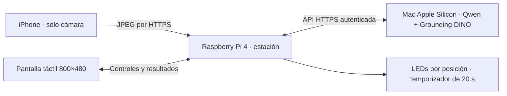
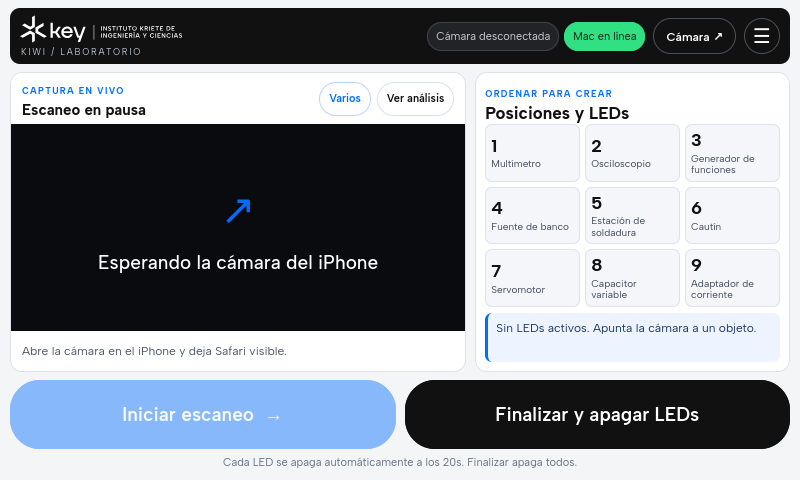

# Kiwi · herramientas, cámara y Raspberry Pi

Prototipo de **KEY Week / ToolLighthouse** para identificar herramientas de laboratorio y señalar sus posiciones. El **iPhone funciona únicamente como webcam**, la **Raspberry Pi controla la interfaz y los LEDs**, y el **Mac ejecuta los modelos localmente**. Colab se conserva como alternativa.





## Flujo actual

1. **Mac:** carga Qwen3-VL-4B-Instruct en MLX de 4 bits y Grounding DINO tiny en PyTorch MPS. Prepara los modelos antes de anunciar disponibilidad. Tras la descarga inicial, este flujo puede funcionar sin internet en una misma red local.
2. **iPhone:** abre `https://<IP_RASPBERRY>:8000/camera`, se empareja con el código mostrado por la estación y permite la cámara. Safari debe permanecer visible, con el teléfono desbloqueado.
3. **Raspberry:** muestra **Mac en línea**, recibe las imágenes recientes y permite iniciar, pausar, finalizar y cambiar de modo. Todos esos controles están en su pantalla; el teléfono solo captura.
4. **Reconocimiento:** la Pi solicita el análisis al Mac. Los resultados se validan antes de aceptar una categoría; las respuestas de un ciclo terminado se descartan.
5. **Posiciones:** cada herramienta aceptada señala su ubicación y muestra una cuenta regresiva. En la instalación sin sensores, cada LED se apaga a los **20 segundos**. **Finalizar y apagar LEDs** los apaga de inmediato y prepara un ciclo nuevo.

| Modo | Uso | Procesamiento |
|---|---|---|
| **Rápido · 1** | Una herramienta por vez | Qwen clasifica la imagen completa y exige dos respuestas coincidentes. No ejecuta DINO. |
| **Varios** | Varias herramientas separadas en la misma escena; objetivo de prueba: tres | DINO localiza, la Pi sigue los objetos estables y Qwen clasifica los recortes por lotes. Una detección posterior compatible confirma cada resultado. |

En **Varios**, se revisan hasta seis recortes estables por ciclo, en lotes de hasta tres. Se filtran propuestas duplicadas o contenidas y se conserva la identificación de los objetos ya aceptados. La configuración local del Mac admite hasta dos inicios de análisis por segundo, con una operación a la vez y sin acumular imágenes antiguas. La frecuencia efectiva depende de la inferencia y de la red; no equivale a vídeo reconocido a 2 FPS.

**Pausar** detiene el análisis; los temporizadores continúan. Si la cámara pierde conexión durante cuatro segundos, se pausa el escaneo. Al reiniciar el servidor de la Pi hay que volver a conectar el teléfono.

## Arranque de la instalación preparada

1. En el Mac, abrir **Iniciar_Kiwi_Mac.command**, disponible en su escritorio. Mantenerlo encendido, con la tapa abierta y en el mismo Wi-Fi que la Raspberry y el iPhone.
2. Encender la Raspberry y esperar a que abra Kiwi. Si no aparece, usar **Kiwi herramientas** desde su escritorio.
3. Esperar al indicador **Mac en línea**. El primer arranque prepara los modelos antes de aceptar solicitudes.
4. Tocar **Cámara ↗** en la Raspberry: muestra la dirección actual, un QR y el código de conexión. Usar esa dirección en Safari; no depender de `kite.local`.
5. Conectar la cámara y, desde la Raspberry, seleccionar **Varios** o **Rápido · 1** y tocar **Iniciar escaneo**.

Para apagar la Pi: **Finalizar y apagar LEDs → ☰ → Salir al escritorio → menú Raspberry → Shutdown / Apagar**. Esperar a que termine antes de desconectar la energía. Para detener los modelos en el Mac, abrir **Detener_Kiwi_Mac.command**.

La Pi actualiza su dirección de cámara, certificado y QR al arrancar con Wi-Fi. Si cambia la **IP del Mac**, hay que actualizar el endpoint de la Pi y el certificado del servidor Mac. Las IP y certificados de una instalación no se deben copiar a otra sin configurarlos.

## Preparar el Mac desde el repositorio

Requiere Apple Silicon y Python 3.12. El entorno probado es **MacBook Pro M5, 16 GB**. Los pesos no se incluyen en Git; Qwen MLX ocupa aproximadamente 3,1 GB de descarga, además del detector y las dependencias.

```bash
git clone https://github.com/fcanas574/kiwi.git
cd kiwi
python3.12 -m venv mac/.venv
mac/.venv/bin/python -m pip install -r mac/requirements.lock.txt
mac/.venv/bin/python -c 'from huggingface_hub import snapshot_download; [snapshot_download(model, allow_patterns=["*.json", "*.safetensors", "*.txt", "*.jinja"]) for model in ("mlx-community/Qwen3-VL-4B-Instruct-4bit", "IDEA-Research/grounding-dino-tiny")]'
```

Copiar [`mac/.env.example`](mac/.env.example) a `mac/.env` **solo si no existe**, y configurar una clave de API de al menos 16 caracteres. El archivo es JSON, privado y excluido de Git. La Pi debe usar la misma clave en `KIWI_API_KEY`; el código de emparejamiento del teléfono es distinto.

Para una prueba HTTP limitada al propio Mac, conservar `host: 127.0.0.1` y los certificados vacíos del ejemplo. El acceso desde la Raspberry requiere **HTTPS**: configurar `host: 0.0.0.0`, certificado y clave del servidor, y confiar en su CA desde el cliente Pi. El certificado debe incluir la IP del Mac en el SAN. No desactivar la validación TLS ni copiar la clave privada de la CA al teléfono o al repositorio.

Los lanzadores portables están en [`mac/Iniciar_Kiwi_Mac.command`](mac/Iniciar_Kiwi_Mac.command) y [`mac/Detener_Kiwi_Mac.command`](mac/Detener_Kiwi_Mac.command). También pueden ejecutarse desde la carpeta del repositorio:

```bash
bash mac/Iniciar_Kiwi_Mac.command
# Para detenerlo:
bash mac/Detener_Kiwi_Mac.command
```

El lanzador evita cargar otra copia del servidor si ya está activo. Guarda los mensajes en `mac/results/server.log` y usa modelos locales, por lo que deben estar descargados antes de iniciarlo. Ver [Mac: instalación, TLS y funcionamiento](mac/README.md).

## Configuración de la Raspberry

Ver [instalación y drivers](pi/README.md) y [preparación HTTPS del iPhone](docs/local-phone-setup.md). La configuración y las claves de la instalación activa se conservan en la Pi y no se versionan.

Este fragmento muestra los ajustes utilizados con el Mac; se combina con las nueve posiciones y el cableado propios de la estación:

```yaml
recognizer:
  driver: rest
  url: https://<IP_MAC>:8003/predict
  tls_ca_file: /ruta/a/la/ca-del-servidor.crt
scan:
  mode: tracked
  max_fps: 2
  stable_samples: 2
  stable_seconds: 0.35
  stable_iou: 0.5
  area_tolerance: 0.30
  center_tolerance: 0.04
camera:
  driver: none
sensors:
  driver: none
guide:
  continuous_led_seconds: 20
```

`KIWI_API_KEY` autentica las solicitudes al Mac. `KIWI_SCAN_PAIRING_KEY` empareja el teléfono y solo se muestra desde la estación local. Las claves, cookies, certificados privados, entornos y logs no se suben a Git. Un endpoint guardado en `pi/data/settings.json` tiene prioridad sobre `config.yaml`; cambiar solo el YAML puede no cambiar el servidor activo.

La estación instalada usa **Firefox** en una pantalla de **800×480**, con identidad visual inspirada en KEY Institute. La vista del teléfono es independiente. La interfaz anterior de fotografías manuales y diagnóstico sigue en `/legacy` y `/legacy?diag`, accesibles desde la Pi.

**Sin sensores**, Kiwi identifica y señala posiciones, pero no verifica que una herramienta fue devuelta físicamente. Los drivers opcionales de sensores permanecen disponibles. Varios objetos de la misma categoría comparten una ubicación y un LED; un sensor de presencia tampoco identifica qué objeto se depositó.

## Rendimiento medido y límites

Prueba del **14 de octubre de 2026**, después de reiniciar y preparar los modelos, desde Raspberry Pi 4 hacia el Mac por HTTPS/Wi-Fi:

| Prueba | Resultado |
|---|---|
| Tres categorías, cinco ejecuciones | **4,216–4,922 s** hasta confirmar las tres |
| Categorías del montaje | Multímetro, servomotor y cautín |
| Posiciones adicionales aceptadas | Ninguna en esas cinco ejecuciones |
| Rápido · 1 | **1,189 s** para el recorte del multímetro |
| Hardware de salida en la medición | **LEDs simulados**; los físicos estaban desconectados |

Estos tiempos corresponden a un **montaje artificial de fotografías de referencia**, no a tres herramientas reales filmadas a 45°. El margen respecto al objetivo de cinco segundos es pequeño. **No se garantiza ese máximo en todas las escenas**, ni se ha medido una precisión global. Faltan las pruebas de cámara real con varios objetos y la comprobación física de LEDs tras la migración.

Qwen usa una puntuación relativa entre categorías con umbrales iniciales de **0,90** y margen **0,50**. Esos valores no son porcentajes de acierto calibrados. `otros`, categorías sin posición y resultados ambiguos se rechazan. No se entrenó un detector específico del laboratorio. Presentar objetos completos, separados y con el frente visible.

Los resultados iniciales más lentos también se conservan: [medición inicial Pi/Mac](mac/results/pi-mac-benchmark.initial.json), [medición final Pi/Mac](mac/results/pi-mac-benchmark.json), [cómputo del Mac](mac/results/local-model-benchmark.json) y [simulación del flujo completo](mac/results/local-end-to-end.json).

## API, pruebas y dataset

La API Mac usa `Authorization: Bearer …` y conserva:

| Ruta | Función |
|---|---|
| `GET /health` | Disponibilidad y capacidades |
| `POST /detect` | Cuadros de DINO, tamaño de imagen y tiempo |
| `POST /classify` | Clasificación de una imagen o recorte |
| `POST /classify-batch` | Hasta tres recortes, con correlación individual |
| `POST /predict` | Reconocimiento manual multiobjeto compatible con el flujo anterior |

El cliente Pi descubre los lotes en `/health`; al usar Colab sin esa capacidad conserva el procesamiento de un recorte por ciclo. Antes de aceptar resultados se verifican sesión, generación, cuadro, seguimiento y revisión. Finalizar descarta respuestas tardías. Los detalles de API y las correcciones por recorte están en [pi/README.md](pi/README.md).

Pruebas sin cargar modelos ni acceder a GPIO:

```bash
PYTHONPATH=pi:mac:pi/tests mac/.venv/bin/python -m pytest -q pi/tests mac/test_server.py \
  --ignore=pi/tests/test_https_config.py --ignore=pi/tests/test_kiosk_network.py
```

Las pruebas de certificados requieren OpenSSL con verificación de IP/hostname; algunos casos no son compatibles con LibreSSL de macOS y se comprobaron en la Pi. Los benchmarks de [`mac/`](mac/README.md) sí cargan modelos y se ejecutan por separado.

El [dataset preparado](dataset_prepared/README.md) contiene referencias, evaluación y manifiesto. Las correcciones de la interfaz anterior se guardan en `pi/data/feedback/` y pueden incorporarse con `python -m kiwi_pi.dataset`. Añadir referencias no entrena Qwen ni DINO. La etiqueta histórica `solder` significa **cautín** en este proyecto.

## Colab como alternativa

[](https://colab.research.google.com/github/fcanas574/kiwi/blob/main/Kiwi_EmbeddingGemma2_Colab.ipynb)

Para volver al backend de Colab: preparar GPU y ejecutar dependencias, configuración, Qwen **5b**, DINO **5c** y REST **6b**. Habilitar `KIWI_API_KEY` y `NGROK_AUTHTOKEN`, y configurar en la Pi el nuevo endpoint `/predict` con su clave correspondiente. Revisar también el endpoint guardado en los ajustes y reiniciar el servicio. La sección **6 de Gradio** sirve al flujo manual y no es necesaria para el teléfono como webcam. EmbeddingGemma es una verificación opcional por recorte, desactivada por defecto.

Colab requiere una sesión activa y el túnel puede cambiar de dirección. Para reproducir el experimento anterior de detector, consultar [colab/MULTIOBJECT_PROBE.md](colab/MULTIOBJECT_PROBE.md).

## Archivos principales

| Ruta | Función |
|---|---|
| [mac/](mac/README.md) | Modelos locales, servidor, lanzadores y benchmarks |
| [pi/](pi/README.md) | Pantalla de estación, cámara del teléfono y control de hardware |
| [Guía de despliegue de la instalación](docs/raspberry-webcam-deployment.md) | Configuración y antecedentes de la Raspberry preparada |
| [Notebook](Kiwi_EmbeddingGemma2_Colab.ipynb) | Backend alternativo en Colab, Gradio y REST |
| [colab/kiwi_multiobject.py](colab/kiwi_multiobject.py) | Detector y recortes del flujo Colab |
| [colab/kiwi_vlm.py](colab/kiwi_vlm.py) | Clasificador Qwen del flujo Colab |
| [dataset_prepared/](dataset_prepared/README.md) | Fotografías y etiquetas |
| [Contexto del reto](Key_Week_Proyecto_Sistema_Inteligente_Herramientas.md) | Objetivos y requisitos |

Los modelos se descargan desde sus repositorios y no se incluyen en Git: [Qwen MLX 4 bits](https://huggingface.co/mlx-community/Qwen3-VL-4B-Instruct-4bit), [Grounding DINO tiny](https://huggingface.co/IDEA-Research/grounding-dino-tiny). La fuente Albert Sans se distribuye con su [licencia OFL](pi/kiwi_pi/static/fonts/OFL.txt).
