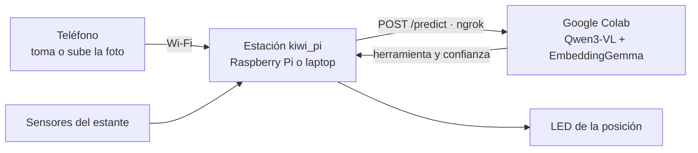

# Kiwi — rama `raspberry-pi-station`

Sistema completo del reto de **Key Week**: una persona fotografía una herramienta con el **teléfono**, la IA en **Google Colab** la reconoce y una **Raspberry Pi 4** enciende el LED de su lugar en el estante y verifica con sensores que se devolvió a la posición correcta. La interfaz sigue el diseño de Figma (**ToolLighthouse**: Captura → Revisión → Resultado).

[](https://colab.research.google.com/github/fcanas574/kiwi/blob/raspberry-pi-station/Kiwi_EmbeddingGemma2_Colab.ipynb)

> Esta rama se separó de `main` para no modificarla. Contiene la estación de la Raspberry Pi, la API REST de Colab y el reconocimiento con un VLM.



## Qué hay de nuevo en esta rama

| Ruta | Qué es |
|---|---|
| [`Kiwi_EmbeddingGemma2_Colab.ipynb`](Kiwi_EmbeddingGemma2_Colab.ipynb) | Notebook con dos secciones nuevas: **5b** (reconocimiento con VLM) y **6b** (API REST con ngrok para la estación). |
| [`colab/kiwi_vlm.py`](colab/kiwi_vlm.py) | El mismo código de la sección 5b en un archivo, para ejecutarlo con `exec(...)` desde Drive. |
| [`pi/`](pi/README.md) | Estación: servidor, interfaz táctil del diseño de Figma, drivers de LEDs, sensores y cámara, instalación en la Pi y tests. |
| [`dataset_prepared/`](dataset_prepared/README.md) | 8 fotos nuevas tomadas con el teléfono y la categoría `otros` (objetos que no deben encender un LED). `references.zip` regenerado. |

### Cómo reconoce las herramientas

1. **VLM Qwen3-VL-4B-Instruct (sección 5b):** recibe la foto y una pregunta de opción múltiple con las herramientas. Ya sabe qué es un multímetro, una resistencia o un Arduino, así que **no necesita fotos de referencia** y rechaza solo los objetos ajenos.
2. **Doble verificación con EmbeddingGemma 2 (secciones 4–5):** si la herramienta tiene fotos de referencia y EmbeddingGemma elige otra, no se enciende ningún LED.
3. **Regla de aceptación:** probabilidad ≥ 0,90 y ventaja ≥ 0,50 sobre la segunda opción. Si no se cumple, la pantalla pide repetir la foto.

**Evaluación (12/10/2026, 55 fotos del dataset y pruebas con el teléfono):**
- Todas las herramientas vistas **de frente** se reconocieron.
- Las vistas traseras o laterales de los equipos de banco se rechazan con «Muestra el frente».
- Resistencias, Arduino, alicate y papel toalla no encienden ningún LED.
- Cada foto tarda menos de 1 s en una GPU T4.

## Guía para un compañero que trabaja desde otra casa

Colab corre en la nube de Google, así que funciona desde cualquier internet. Lo único local es la **página de la estación**: la abre el teléfono conectado al mismo Wi-Fi que la computadora (o la Pi) que la sirve. Cada persona usa **su propio Colab, su propia cuenta de ngrok y su propia estación**.

### 1. Preparar Google Drive y los secretos de Colab

1. Descargar [`dataset_prepared/references.zip`](dataset_prepared/references.zip) de esta rama y guardarlo en **Mi unidad → Kiwi → references.zip**. Sirve para la doble verificación; sin él, cambiar `LOAD_REFERENCE_ZIP = False` en la sección 5.
2. Crear una cuenta gratuita en [ngrok](https://ngrok.com) y copiar su *authtoken*.
3. Abrir el notebook con el botón **Abrir en Colab** de arriba y guardar una copia en Drive (**Archivo → Guardar una copia en Drive**).
4. En Colab, en **Secretos** (icono de llave), crear y dar acceso al notebook:
   - `NGROK_AUTHTOKEN`: el token de ngrok.
   - `KIWI_API_KEY`: una clave inventada de 16 caracteres o más. Se usa después en la estación.
5. **Entorno de ejecución → Cambiar tipo de entorno → GPU T4**.

### 2. Ejecutar el notebook

| Sección | Para qué | Notas |
|---|---|---|
| 1–3 | Dependencias, Drive y modelo EmbeddingGemma | Autorizar Drive. Si pide reiniciar la sesión tras instalar, reiniciar y seguir. |
| 4–5 | Comparación por fotos y carga de `references.zip` | Debe imprimir `Referencias cargadas: {...}`. |
| **5b** | **VLM Qwen3-VL** | La primera vez descarga ~9 GB (unos 4 min). Debe imprimir `Reconocimiento activo: VLM ...`. |
| 6 | Página de Gradio (opcional) | Enlace `gradio.live` para probar el reconocimiento desde cualquier teléfono, sin estación. |
| **6b** | **API para la estación** | Imprime `Endpoint para la Raspberry Pi: https://….ngrok-free.app/predict`. Copiar esa URL. |

Si se ejecuta otra vez la sección 4, hay que volver a ejecutar la 5b, porque la 4 restablece el reconocimiento por fotos.

### 3. Probar solo el reconocimiento (lo más rápido)

Abrir en el teléfono el enlace `gradio.live` de la sección 6 (usuario `kiwi` y la contraseña que se escribió en la celda). Subir una foto y pulsar **Identificar**. La respuesta muestra `candidate`, `similarity` (la probabilidad) y `recognized`.

### 4. Correr la estación en una laptop (sin Raspberry Pi)

Requiere Python 3.10 o superior. Los LEDs y sensores se simulan.

```bash
git clone -b raspberry-pi-station https://github.com/fcanas574/kiwi.git && cd kiwi/pi
```

```bash
python3 -m venv .venv && .venv/bin/pip install -r requirements-dev.txt && cp config.example.yaml config.yaml
```

En `pi/config.yaml` poner la URL de la sección 6b en `recognizer.url`. La clave va en una variable de entorno, no en el archivo:

```bash
KIWI_API_KEY='la-misma-clave-del-secreto-de-colab' .venv/bin/python -m kiwi_pi --sim-hardware
```

En Windows (PowerShell): `$env:KIWI_API_KEY='la-clave'; .venv\Scripts\python -m kiwi_pi --sim-hardware` (crear el entorno con `python -m venv .venv` y `.venv\Scripts\pip install -r requirements-dev.txt`).

- Abrir en el teléfono, conectado al **mismo Wi-Fi** que la laptop: `http://<IP-de-la-laptop>:8000`. Para ver la IP en Mac: `ipconfig getifaddr en0`; en Windows: `ipconfig`.
- En la laptop, `http://localhost:8000/?diag` (o mantener pulsado el logo) abre el **diagnóstico**: ahí se ve qué LED se encendería y se pueden simular los sensores.
- La barra superior debe decir **API en línea**. Si dice «sin conexión», revisar la URL y la clave.
- Sin Colab se puede probar la interfaz con `.venv/bin/python -m kiwi_pi --mock`, que simula también el reconocimiento.

### 5. Instalar en la Raspberry Pi 4

Ver [pi/README.md](pi/README.md): instalación con `deploy/install.sh`, pantalla en modo kiosco, conexión de LEDs (GPIO, tira WS2812 o ESP32/Arduino) y sensores (IR, microswitch, reed), y lista de verificación para la demo.

## Mejorar el reconocimiento

- **Agregar o cambiar una herramienta:** editar su descripción en `CATEGORIES` (sección 2) y, si se parece a otra, en `VLM_DESCRIPTIONS` (sección 5b). El VLM no necesita fotos.
- **Correcciones desde la estación:** al pulsar **No es correcta** la pantalla pregunta **¿Qué era?** y guarda la foto con su etiqueta real. `.venv/bin/python -m kiwi_pi.dataset` las incorpora a `dataset_prepared/references/` y regenera `references.zip`; después hay que subir el ZIP a Drive y ejecutar las secciones 4, 5 y 5b.
- **Para la demo:** mostrar cada equipo **de frente** a la cámara.

## Pendientes

- Probar desde el teléfono las 9 herramientas de frente; hasta ahora solo se probaron objetos ajenos con el VLM.
- Definir los sensores del estante y la conexión de los LEDs en la Raspberry Pi real.
- Las 9 herramientas de `pi/config.example.yaml` son provisionales: se dejaron fuera `capacitors` y `multimeter_box`.
- Colab gratuito y ngrok son temporales: la URL cambia al reiniciar la sección 6b y hay que pegarla de nuevo en la estación.

## Categorías

`soldering_station`, `digital_multimeter`, `bench_power_supply`, `servo_motor`, `oscilloscope`, `function_generator`, `variable_capacitor`, `capacitors`, `power_adapter`, `multimeter_box`, `solder` y `otros` (referencias negativas). En este proyecto **`solder` identifica el cautín** (*soldering iron*), no el alambre de soldadura.

## Contexto y fuentes

- [Documento del reto](Key_Week_Proyecto_Sistema_Inteligente_Herramientas.md): objetivos, requisitos y cronograma.
- [Dataset preparado](dataset_prepared/README.md) y [manifiesto](dataset_prepared/manifest.csv); `Kiwi Dataset/` conserva las fotos originales.
- [Qwen3-VL-4B-Instruct](https://huggingface.co/Qwen/Qwen3-VL-4B-Instruct) · [EmbeddingGemma 2](https://huggingface.co/google/embeddinggemma-2) · [guía multimodal de EmbeddingGemma](https://ai.google.dev/gemma/docs/embeddinggemma/multimodal-embeddinggemma-with-sentence-transformers)
- [Gradio: enlaces y API](https://gradio.app/guides/sharing-your-app) · [ngrok](https://ngrok.com/docs) · [Condiciones de Colab](https://research.google.com/colaboratory/faq.html)

Los pesos de los modelos se descargan desde su fuente oficial y no se incluyen en este repositorio. No se realiza fine-tuning: los dos modelos son preentrenados.
