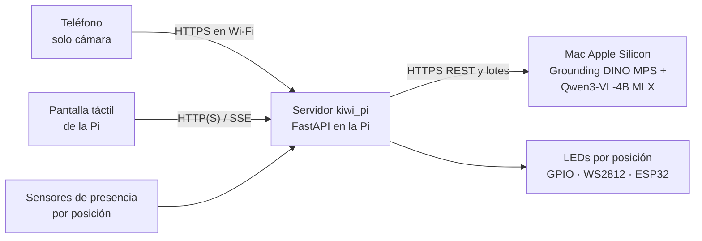

# Estación Raspberry Pi — ToolLighthouse

Estación con dos pantallas: el teléfono funciona como cámara y la pantalla táctil de la Raspberry controla el escaneo, muestra los resultados y permite apagar los LEDs. La vista de estación cabe en una pantalla horizontal de 800×480. Grounding DINO y Qwen corren localmente en el Mac (Colab es una alternativa); la Pi recibe las imágenes, coordina el reconocimiento y controla los LEDs. Si existen sensores, también verifica presencia por ubicación. El flujo anterior de fotos manuales y diagnóstico se conserva en `/legacy`, accesible solo desde la estación.



1. **Capturar**: el teléfono abre `https://<IP-reservada>:8000/camera`, se empareja y envía cuadros recientes. Antes se instala y confía la CA local siguiendo [la guía HTTPS del teléfono](../docs/local-phone-setup.md). Todos los controles de escaneo están en la Raspberry.
2. **Procesar**: en Varios, el Mac localiza los objetos con DINO y clasifica recortes con Qwen; en Rápido · 1 clasifica la imagen completa. La Pi valida los resultados y busca las ubicaciones en `config.yaml`.
3. **Comunicar**: la Pi controla los LEDs por GPIO, tira WS2812 o un microcontrolador por USB.
4. **Señalizar**: en la instalación sin sensores, cada LED se apaga a los 20 segundos; Finalizar lo apaga antes. Con sensores instalados, cada ubicación puede verificar presencia de forma independiente. Un sensor de presencia no identifica la herramienta.

## Estructura

| Ruta | Contenido |
|---|---|
| `kiwi_pi/app.py` | Rutas HTTP: fotos, reconocimiento, eventos en vivo y diagnóstico |
| `kiwi_pi/station.py` | Guía y verificación de devolución (fases `guiding`, `wrong_slot`, `returned`, `timeout`) |
| `kiwi_pi/recognizer.py` | Clientes Mac/Colab (`rest`), Gradio y simulación (`mock`) y decisión de aceptación |
| `kiwi_pi/leds.py` · `sensors.py` · `camera.py` | Drivers de hardware intercambiables |
| `kiwi_pi/static/` | Interfaz táctil (HTML/CSS/JS sin compilación) |
| `config.example.yaml` | Herramientas, posiciones, pines y drivers |
| `deploy/` | Instalación, servicio systemd y kiosco |
| `firmware/kiwi_leds/` | Sketch opcional para LEDs en ESP32/Arduino |

## Probar en una computadora (sin hardware)

```bash
cd pi && python3 -m venv .venv && .venv/bin/pip install -r requirements-dev.txt
```

```bash
.venv/bin/python -m kiwi_pi --mock
```

Abrir `http://localhost:8000`. `--mock` simula API, LEDs y sensores. El panel de diagnóstico anterior está en `/legacy?diag`: colocar/retirar herramientas en cada posición, forzar el resultado de la API y probar los LEDs. Tests: `.venv/bin/python -m pytest -q tests`.

## Probar por fases: primero el reconocimiento, después la Pi

El mismo código corre en una laptop y en la Pi; entre fases solo cambian los drivers de `config.yaml`.

**Fase 1 — reconocimiento real desde el teléfono, sin Pi.** LEDs y sensores simulados en la laptop.

1. Iniciar el [servidor local del Mac](../mac/README.md) y usar su endpoint `/predict`. Como alternativa, ejecutar Qwen/DINO y REST 6b en Colab y copiar su URL.
2. En la laptop, crear la configuración: `cp config.example.yaml config.yaml` y editar en `config.yaml`:
   - `recognizer.url`: la URL copiada.
   - Mantener `decision.test_mode: false` para respetar el rechazo del modelo. Usar modo prueba únicamente con hardware simulado y durante pruebas controladas.
3. Arrancar con la misma clave que el backend:
   ```bash
   KIWI_API_KEY='la-misma-clave-del-backend' .venv/bin/python -m kiwi_pi --sim-hardware
   ```
4. Desde la laptop, abrir `http://localhost:8000/legacy` para subir fotografías manuales. Para usar el teléfono como cámara, preparar HTTPS local y abrir `/camera` desde el teléfono en la misma Wi-Fi.
5. En el navegador de la laptop, `http://localhost:8000/legacy?diag` muestra los LEDs que se encenderían y permite simular sensores (colocar en la posición correcta o en otra).

En esta fase conviene registrar objetos omitidos, duplicados, confusiones y tiempos. **Corregir** en cada objeto guarda su recorte, no la foto completa, para ampliar las referencias.

**Fase 2 — en la Raspberry Pi.** Instalar con `deploy/install.sh` (abajo), copiar los mismos valores de `recognizer` y `decision` al `config.yaml` de la Pi, reservar una IP para ella en el router y seguir [la guía HTTPS del teléfono](../docs/local-phone-setup.md). El kiosco y el teléfono usan `server.public_url` con esa IP. Se puede pasar por partes: primero solo LEDs reales con `sensors.driver: mock`, luego los sensores.

## Instalar en la Raspberry Pi 4

Requisitos: Raspberry Pi OS Bookworm de 64 bits con escritorio, pantalla táctil (oficial de 7" por DSI, Touch Display 2 o HDMI + USB), conexión a internet y la misma red Wi-Fi que los teléfonos.

```bash
git clone https://github.com/fcanas574/kiwi.git ~/kiwi && cd ~/kiwi/pi && bash deploy/install.sh
```

El script instala dependencias, crea `config.yaml` y `.env`, registra el servicio `kiwi` y abre Chromium en modo kiosco al iniciar sesión. La configuración inicial conserva HTTP para desarrollo. Para la cámara del teléfono, reserva una IP y prepara HTTPS con [la guía HTTPS del teléfono](../docs/local-phone-setup.md). Después:

1. Iniciar el servidor Mac y configurar `recognizer.url: https://<IP_MAC>:8003/predict` y `recognizer.tls_ca_file` con la CA correspondiente. Para Colab, ejecutar Qwen/DINO y REST 6b y usar su URL en lugar del Mac.
2. Poner la clave en `~/kiwi/pi/.env` (`KIWI_API_KEY=…`, la misma del backend Mac o Colab) y `sudo systemctl restart kiwi`.
3. Pegar la URL en **Endpoint de Colab** del panel local `/legacy?diag` o en `recognizer.url`. El indicador debe cambiar a **Mac en línea** para el servidor local, o **API en línea** para Colab. Revisar también `data/settings.json`, cuyo endpoint guardado tiene prioridad sobre el YAML.
4. Ajustar en `config.yaml` las 9 herramientas, sus posiciones y los drivers de LEDs y sensores. Reiniciar con `sudo systemctl restart kiwi`.

La pantalla principal de estación está diseñada para horizontal (800×480). El teléfono tiene una vista independiente de cámara. El teclado en pantalla de Raspberry Pi OS (*squeekboard*) aparece al tocar el campo del endpoint en el diagnóstico anterior.

La instalación ya preparada usa Raspberry Pi OS 13, pantalla de 5 pulgadas, Firefox y servicios del usuario (`systemctl --user`), con la aplicación en `/home/testuser/kiwi-pruebas/pi`. El instalador genérico anterior usa servicios del sistema y Chromium: no volver a ejecutarlo sobre esa instalación para reiniciar. Ver [despliegue preparado](../docs/raspberry-webcam-deployment.md).

## Teléfono como webcam y controles en la Raspberry

El teléfono dedicado y la Raspberry deben usar la misma Wi‑Fi. Reserva la IP de la Pi y completa [la preparación HTTPS local](../docs/local-phone-setup.md), incluida la confianza de la CA en el teléfono. Si cambias de teléfono, instala y confía la CA en el nuevo dispositivo antes de abrir Kiwi; cada navegador necesita esa preparación para dar acceso a la cámara.

En el `.env` de la instalación, configura la clave del backend y un código de emparejamiento distinto:

```dotenv
KIWI_API_KEY=la-misma-clave-del-backend
KIWI_SCAN_PAIRING_KEY=un-codigo-distinto-para-el-telefono
```

Reinicia `kiwi`, abre `https://<IP-reservada>:8000/camera` en el teléfono y conecta con el código. El código y la dirección aparecen en el botón **Cámara** de la Raspberry. La página del teléfono solo muestra cámara y conexión, y no recibe `KIWI_API_KEY`. Safari puede requerir tocar **Activar cámara** para conceder el permiso inicial. Deja Safari visible y el teléfono fijo.

En la Raspberry, **Iniciar escaneo** analiza las imágenes, **Pausar análisis** conserva las guías y **Finalizar y apagar LEDs** apaga las luces y prepara un ciclo nuevo, incluso para repetir con el mismo objeto. Si la cámara deja de enviar imágenes durante cuatro segundos, el análisis se pausa y descarta respuestas pendientes; reconecta el teléfono y vuelve a iniciar desde la Raspberry. La página raíz selecciona estación para conexiones locales y cámara para conexiones remotas; `/station` y los controles nuevos solo admiten administración local.

El botón de modo en la Raspberry cambia, con el escaneo pausado, entre **Rápido · 1** (`scan.mode: single`) y **Varios** (`scan.mode: tracked`). Rápido clasifica la imagen completa con Qwen y exige dos respuestas coincidentes para un instrumento presentado por vez. Varios usa Grounding DINO para recortar instrumentos y verificar temporalmente cada uno. La selección se guarda en los ajustes locales. La instalación Mac está preparada en Varios y permite alternar a Rápido. El Mac clasifica hasta seis recortes estables por ciclo, en lotes de tres, sin repetir continuamente los ya aceptados.

En estaciones sin sensores, `guide.continuous_led_seconds` permite apagar cada LED a partir de su reconocimiento; 0 mantiene la guía hasta finalizar. La instalación de pruebas usa 20 segundos y muestra la cuenta regresiva en cada posición. Pausar no reinicia ese plazo. Mientras el objeto siga visible, el vencimiento no lo rearma ni provoca que el LED vuelva a encenderse.

Una clasificación Qwen queda provisional hasta una detección DINO posterior compatible. Solo una categoría confirmada enciende su ubicación. Después de confirmarla, la categoría se suprime hasta tres detecciones válidas de ausencia; errores o pausas no cuentan como ausencia. Una falla del backend conserva la guía y usa esperas de reintento limitadas. Si Colab reinicia y cambia la URL de ngrok, ejecuta la sección 6b del notebook y actualiza **Endpoint de Colab** desde la pantalla de la Pi.

El teléfono envía cuadros JPEG de hasta 960 px aproximadamente cada 300 ms tras completar cada envío. La Pi conserva solo el último cuadro y permite hasta dos inicios de análisis por segundo con el Mac (`scan.max_fps: 2`), sin solicitudes simultáneas ni cola de imágenes antiguas. Los valores del ejemplo genérico conservan 1. DINO y Qwen se ejecutan en el backend, no en la Pi. La velocidad depende de los modelos y de la red. Se filtran propuestas duplicadas o contenidas de DINO antes del seguimiento para evitar confundir un instrumento y sus componentes. Coloca objetos separados, sin superponerlos; `scan.detection_nms_iou` y `scan.detection_containment` permiten ajustar este filtro.

El modo manual existente sigue disponible en `/legacy` desde la estación. Gradio sirve para ese flujo manual; el escaneo continuo necesita REST (`/detect` y `/classify`, más `/classify-batch` si el backend lo anuncia).

## Conexiones

Numeración **BCM**. Pines por defecto (cambiar en `config.yaml`):

| Posición | 1 | 2 | 3 | 4 | 5 | 6 | 7 | 8 | 9 |
|---|---|---|---|---|---|---|---|---|---|
| LED (`leds.gpio_pins`) | 5 | 6 | 13 | 19 | 26 | 12 | 16 | 20 | 21 |
| Sensor (`sensors.gpio_pins`) | 4 | 17 | 27 | 22 | 23 | 24 | 25 | 8 | 7 |

Se reservan GPIO 2–3 (I²C, para sensores futuros), 14–15 (UART) y 18 (tira WS2812).

### LEDs (`leds.driver`)

| Driver | Hardware | Notas |
|---|---|---|
| `gpio` | 1 LED por posición: GPIO → resistencia 330 Ω → LED → GND | Un pin GPIO entrega pocos mA. Para barras de LED usar un transistor/MOSFET (p. ej. 2N2222 o módulo de relé/MOSFET) y fuente externa. Sin colores: la Pi usa patrones (fijo, destellos, parpadeo rápido). |
| `ws281x` | Tira WS2812B en GPIO18, `ws281x_pixels_per_slot` LEDs por posición | Colores azul/verde/rojo. Alimentar la tira con 5 V externos y unir GND con la Pi; idealmente un conversor de nivel 3,3→5 V en datos. Requiere `pip install rpi_ws281x` y ejecutar como root. |
| `serial` | ESP32/Arduino por USB con `firmware/kiwi_leds` | Útil si el microcontrolador entregado por los organizadores debe controlar las luces. Requiere `pip install pyserial`. |
| `mock` | Ninguno | Estado visible en el panel de diagnóstico. |

### Sensores (`sensors.driver`)

Los sensores todavía no están definidos. Cualquier sensor digital por posición funciona con `gpio`; `pull` y `occupied_when` adaptan la lógica:

| Sensor | Conexión | `pull` | `occupied_when` | Comentario |
|---|---|---|---|---|
| IR de obstáculo FC-51 / TCRT5000 | VCC 3,3 V, GND, OUT → GPIO | `up` | `low` | Barato y sin contacto; ajustar el potenciómetro y evitar luz solar directa. |
| Microswitch / final de carrera | Entre GPIO y GND | `up` | `low` | El peso de la herramienta presiona la palanca. Muy fiable. |
| Reed + imán | Entre GPIO y GND | `up` | `low` | Imán pegado a la herramienta o a su soporte. |
| Barrera IR (emisor/receptor) | Salida del receptor → GPIO | `up` | `high` | El objeto corta el haz. Verificar la polaridad del módulo. |

Probar cada sensor en el panel de diagnóstico (columna **Sensor**) antes de la demostración; `debounce_ms` evita lecturas falsas al acomodar la herramienta.

**Límite:** un sensor de presencia sabe que *algo* se colocó, no *qué* se colocó. La estación espera cambios independientes en todas las ubicaciones objetivo. Detecta ocupaciones en ubicaciones ajenas que estaban vacías. Varias detecciones de la misma categoría comparten un LED y una comprobación; no se cuenta el número de unidades. Una ubicación ocupada al iniciar requiere liberación antes de confirmar una nueva devolución. Para identificar la herramienta en el estante se puede escribir otro driver con `read()` (ver `sensors.py`) usando celdas de carga HX711 (peso característico), sensores de distancia VL53L0X por I²C o etiquetas RFID/NFC.

Con `sensors.driver: none` la estación solo guía. El escaneo continuo usa `continuous_led_seconds` si es mayor que cero; la instalación usa 20 segundos por posición. El flujo manual conserva su propio `guide_timeout_seconds`.

## Reconocimiento y devoluciones múltiples

En **Varios**, el flujo es **Grounding DINO → recortes → Qwen3-VL-4B**; **Rápido · 1** utiliza Qwen sin detector. REST y Gradio entregan la misma lista: REST `/predict` devuelve JSON; Gradio `/identify` devuelve foto anotada, galería y JSON (tercera salida). El cliente de la Pi valida cuadros, dimensiones, IDs y puntuaciones antes de encender luces.

- Cada objeto se acepta o rechaza individualmente. Solo categorías con ubicación configurada encienden LEDs; un rechazado no impide guiar los demás aceptados.
- Qwen aplica criterios iniciales de puntuación 0,90 y margen 0,50. No son probabilidades calibradas. Mantener `decision.test_mode: false` para respetar sus rechazos.
- EmbeddingGemma es verificación adicional por recorte, desactivada por defecto. Para usarla, activar `VLM_CHECK_WITH_REFERENCES=True` y cargar referencias en Colab. No reemplaza DINO/Qwen.
- La estación muestra cuadros de análisis, posiciones aceptadas y cuentas regresivas. La interfaz anterior con sensores conserva «N de M ubicaciones confirmadas»; una retirada revierte su confirmación si la operación sigue pendiente.
- **Corregir** guarda solo el recorte elegido en `data/feedback/<etiqueta real>/`. `python -m kiwi_pi.dataset` incorpora esos recortes a las referencias; subir el ZIP a Drive solo si se usa la verificación adicional.
- `recognizer.timeout_seconds: 1800` admite el experimento CPU lento; ajustar tras medir GPU. El timeout del túnel puede ser distinto. `guide_timeout_seconds` comienza después del reconocimiento y limita las devoluciones, no la inferencia.
- Sin sensores, se muestran lugares y se encienden luces, pero no se declara una devolución verificada.

## Antes de la demostración

- [ ] **Mac en línea** en la barra superior; ambos modos disponibles y cámara conectada.
- [ ] **Probar LEDs** enciende las posiciones 1→9 en orden y en el lugar correcto.
- [ ] Si hay sensores instalados, cada uno cambia entre Vacía/Ocupada al colocar y retirar su herramienta.
- [ ] Varias herramientas de la misma foto encienden sus ubicaciones; los objetos rechazados no encienden LEDs.
- [ ] Sin sensores: cada LED se apaga a los 20 segundos y Finalizar los apaga de inmediato. Con sensores: probar devolución parcial y posición equivocada.
- [ ] Umbrales calibrados y `test_mode: false`.
- [ ] Plan de recuperación: abrir el lanzador Mac, revisar Wi-Fi y endpoint; si cambia su IP, actualizar también el certificado. Para Colab, reiniciar REST 6b y actualizar su URL.

## Verificación de software

Desde `pi/`: `.venv/bin/python -m pytest -q tests`. Con Node.js instalado, `node --test tests/test_ui_requests.cjs tests/test_ui_multiobject.cjs` comprueba que las respuestas de fotos descartadas no vuelvan a mostrarse. Estas pruebas no validan los pines ni el modelo en una GPU.
