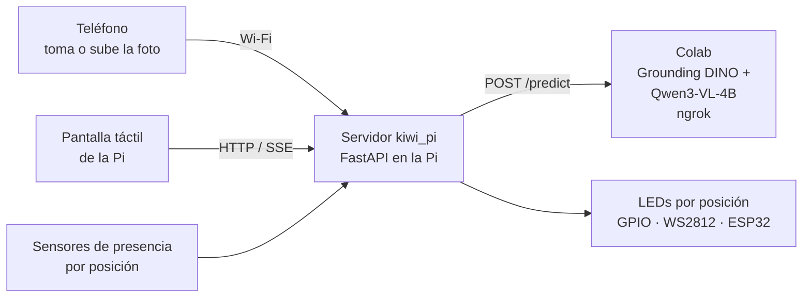

# Estación Raspberry Pi — ToolLighthouse

Interfaz del diseño de Figma (**Captura → Revisión → Resultado**) servida por una Raspberry Pi 4. La foto se toma o se sube **desde el teléfono**; la Pi hace de puente: la envía al modelo de Colab, enciende los LEDs de todas las ubicaciones aceptadas y, con sensores en el estante, **verifica presencia por ubicación y mantiene pendientes las demás devoluciones**. La pantalla táctil de la Pi muestra la misma interfaz y el panel de diagnóstico.



1. **Reconocer**: el teléfono abre `http://<pi>.local:8000`, toma o sube la foto y la Pi la recibe. (Opcional: `camera.driver: auto` para usar una cámara conectada a la Pi.)
2. **Procesar**: Colab devuelve `objects` e `image_size`; la Pi evalúa cada recorte y busca todas las ubicaciones aceptadas en `config.yaml`.
3. **Comunicar**: la Pi controla los LEDs por GPIO, tira WS2812 o un microcontrolador por USB.
4. **Señalizar y verificar**: LED azul en cada ubicación pendiente. Cada sensor confirma su ubicación en verde; las demás siguen azules. Solo termina al confirmar todas y retirar objetos de ubicaciones equivocadas.

## Estructura

| Ruta | Contenido |
|---|---|
| `kiwi_pi/app.py` | Rutas HTTP: fotos, reconocimiento, eventos en vivo y diagnóstico |
| `kiwi_pi/station.py` | Guía y verificación de devolución (fases `guiding`, `wrong_slot`, `returned`, `timeout`) |
| `kiwi_pi/recognizer.py` | Clientes de Colab (`rest`, `gradio`, `mock`) y decisión de aceptación |
| `kiwi_pi/leds.py` · `sensors.py` · `camera.py` | Drivers de hardware intercambiables |
| `kiwi_pi/static/` | Interfaz táctil (HTML/CSS/JS sin compilación) |
| `config.example.yaml` | Herramientas, posiciones, pines y drivers |
| `deploy/` | Instalación, servicio systemd y kiosco |
| `firmware/kiwi_leds/` | Sketch opcional para LEDs en ESP32/Arduino |

## Probar en una computadora (sin hardware)

```bash
cd pi && python3 -m venv .venv && .venv/bin/pip install -r requirements-dev.txt
```

```bash
.venv/bin/python -m kiwi_pi --mock
```

Abrir `http://localhost:8000`. `--mock` simula API, LEDs y sensores. **Pulsa el logotipo ToolLighthouse** (o abre `/?diag`) para el panel de diagnóstico: colocar/retirar herramientas en cada posición, forzar el resultado de la API y probar los LEDs. Tests: `.venv/bin/python -m pytest -q tests`.

## Probar por fases: primero el reconocimiento, después la Pi

El mismo código corre en una laptop y en la Pi; entre fases solo cambian los drivers de `config.yaml`.

**Fase 1 — reconocimiento real desde el teléfono, sin Pi.** LEDs y sensores simulados en la laptop.

1. En Colab, ejecutar las secciones 1–5, **5b–5c** (Qwen y DINO) y la **6b**. Copiar la URL `…ngrok-free.app/predict`.
2. En la laptop, crear la configuración: `cp config.example.yaml config.yaml` y editar en `config.yaml`:
   - `recognizer.url`: la URL copiada.
   - Mantener `decision.test_mode: false` para respetar el rechazo del modelo. Usar modo prueba únicamente con hardware simulado y durante pruebas controladas.
3. Arrancar con la clave del secreto de Colab:
   ```bash
   KIWI_API_KEY='la-misma-clave-de-colab' .venv/bin/python -m kiwi_pi --sim-hardware
   ```
4. Con el teléfono en la **misma red Wi-Fi**, abrir `http://<IP-de-la-laptop>:8000` (en Mac: `ipconfig getifaddr en0`; macOS puede pedir permitir conexiones entrantes a Python). Tomar o subir fotos con varias herramientas juntas y objetos ajenos.
5. En el navegador de la laptop, `http://localhost:8000/?diag` muestra los LEDs que se encenderían y permite simular sensores (colocar en la posición correcta o en otra).

En esta fase conviene registrar objetos omitidos, duplicados, confusiones y tiempos. **Corregir** en cada objeto guarda su recorte, no la foto completa, para ampliar las referencias.

**Fase 2 — en la Raspberry Pi.** Instalar con `deploy/install.sh` (abajo), copiar los mismos valores de `recognizer` y `decision` al `config.yaml` de la Pi, y cambiar `leds.driver` y `sensors.driver` a `gpio` (o al hardware elegido) cuando estén conectados. El teléfono abre `http://<nombre-de-la-pi>.local:8000`. Se puede pasar por partes: primero solo LEDs reales con `sensors.driver: mock`, luego los sensores.

## Instalar en la Raspberry Pi 4

Requisitos: Raspberry Pi OS Bookworm de 64 bits con escritorio, pantalla táctil (oficial de 7" por DSI, Touch Display 2 o HDMI + USB), conexión a internet y la misma red Wi-Fi que los teléfonos.

```bash
git clone https://github.com/fcanas574/kiwi.git ~/kiwi && cd ~/kiwi/pi && bash deploy/install.sh
```

El script instala dependencias, crea `config.yaml` y `.env`, registra el servicio `kiwi` y abre Chromium en modo kiosco al iniciar sesión. Después:

1. En Colab, ejecutar las secciones 1–5, **5b–5c** (Qwen y DINO) y la **6b** del notebook. Copiar la URL `…ngrok-free.app/predict`.
2. Poner la clave en `~/kiwi/pi/.env` (`KIWI_API_KEY=…`, la misma del secreto de Colab) y `sudo systemctl restart kiwi`.
3. Pegar la URL en **Endpoint de Colab** de la pantalla (solo editable desde la propia Pi) o en `recognizer.url`. El indicador debe cambiar a **API en línea**.
4. Ajustar en `config.yaml` las 9 herramientas, sus posiciones y los drivers de LEDs y sensores. Reiniciar con `sudo systemctl restart kiwi`.

La pantalla se adapta a vertical (diseño de Figma, 390×844) y horizontal (800×480). Para la pantalla oficial en vertical, rotarla en *Preferencias → Configuración de pantalla*. El teclado en pantalla de Raspberry Pi OS (*squeekboard*) aparece al tocar el campo del endpoint.

## Conexiones

Numeración **BCM**. Pines por defecto (cambiar en `config.yaml`):

| Posición | 1 | 2 | 3 | 4 | 5 | 6 | 7 | 8 | 9 |
|---|---|---|---|---|---|---|---|---|---|
| LED (`leds.gpio_pins`) | 5 | 6 | 13 | 19 | 26 | 12 | 16 | 20 | 21 |
| Sensor (`sensors.gpio_pins`) | 4 | 17 | 27 | 22 | 23 | 24 | 25 | 8 | 7 |

Se reservan GPIO 2–3 (I²C, para sensores futuros), 14–15 (UART) y 18 (tira WS2812).

### LEDs (`leds.driver`)

| Driver | Hardware | Notas |
|---|---|---|
| `gpio` | 1 LED por posición: GPIO → resistencia 330 Ω → LED → GND | Un pin GPIO entrega pocos mA. Para barras de LED usar un transistor/MOSFET (p. ej. 2N2222 o módulo de relé/MOSFET) y fuente externa. Sin colores: la Pi usa patrones (fijo, destellos, parpadeo rápido). |
| `ws281x` | Tira WS2812B en GPIO18, `ws281x_pixels_per_slot` LEDs por posición | Colores azul/verde/rojo. Alimentar la tira con 5 V externos y unir GND con la Pi; idealmente un conversor de nivel 3,3→5 V en datos. Requiere `pip install rpi_ws281x` y ejecutar como root. |
| `serial` | ESP32/Arduino por USB con `firmware/kiwi_leds` | Útil si el microcontrolador entregado por los organizadores debe controlar las luces. Requiere `pip install pyserial`. |
| `mock` | Ninguno | Estado visible en el panel de diagnóstico. |

### Sensores (`sensors.driver`)

Los sensores todavía no están definidos. Cualquier sensor digital por posición funciona con `gpio`; `pull` y `occupied_when` adaptan la lógica:

| Sensor | Conexión | `pull` | `occupied_when` | Comentario |
|---|---|---|---|---|
| IR de obstáculo FC-51 / TCRT5000 | VCC 3,3 V, GND, OUT → GPIO | `up` | `low` | Barato y sin contacto; ajustar el potenciómetro y evitar luz solar directa. |
| Microswitch / final de carrera | Entre GPIO y GND | `up` | `low` | El peso de la herramienta presiona la palanca. Muy fiable. |
| Reed + imán | Entre GPIO y GND | `up` | `low` | Imán pegado a la herramienta o a su soporte. |
| Barrera IR (emisor/receptor) | Salida del receptor → GPIO | `up` | `high` | El objeto corta el haz. Verificar la polaridad del módulo. |

Probar cada sensor en el panel de diagnóstico (columna **Sensor**) antes de la demostración; `debounce_ms` evita lecturas falsas al acomodar la herramienta.

**Límite:** un sensor de presencia sabe que *algo* se colocó, no *qué* se colocó. La estación espera cambios independientes en todas las ubicaciones objetivo. Detecta ocupaciones en ubicaciones ajenas que estaban vacías. Varias detecciones de la misma categoría comparten un LED y una comprobación; no se cuenta el número de unidades. Una ubicación ocupada al iniciar requiere liberación antes de confirmar una nueva devolución. Para identificar la herramienta en el estante se puede escribir otro driver con `read()` (ver `sensors.py`) usando celdas de carga HX711 (peso característico), sensores de distancia VL53L0X por I²C o etiquetas RFID/NFC.

Con `sensors.driver: none` la estación solo guía: el LED se apaga tras `guide_timeout_seconds`.

## Reconocimiento y devoluciones múltiples

El flujo principal siempre es **Grounding DINO → recortes → Qwen3-VL-4B**. REST y Gradio entregan la misma lista: REST `/predict` devuelve JSON; Gradio `/identify` devuelve foto anotada, galería y JSON (tercera salida). El cliente de la Pi valida cuadros, dimensiones, IDs y puntuaciones antes de encender luces.

- Cada objeto se acepta o rechaza individualmente. Solo categorías con ubicación configurada encienden LEDs; un rechazado no impide guiar los demás aceptados.
- Qwen aplica criterios iniciales de puntuación 0,90 y margen 0,50. No son probabilidades calibradas. Mantener `decision.test_mode: false` para respetar sus rechazos.
- EmbeddingGemma es verificación adicional por recorte, desactivada por defecto. Para usarla, activar `VLM_CHECK_WITH_REFERENCES=True` y cargar referencias en Colab. No reemplaza DINO/Qwen.
- La pantalla muestra los cuadros, los objetos aceptados/rechazados y «N de M ubicaciones confirmadas». Una retirada revierte la confirmación si la operación sigue pendiente.
- **Corregir** guarda solo el recorte elegido en `data/feedback/<etiqueta real>/`. `python -m kiwi_pi.dataset` incorpora esos recortes a las referencias; subir el ZIP a Drive solo si se usa la verificación adicional.
- `recognizer.timeout_seconds: 1800` admite el experimento CPU lento; ajustar tras medir GPU. El timeout del túnel puede ser distinto. `guide_timeout_seconds` comienza después del reconocimiento y limita las devoluciones, no la inferencia.
- Sin sensores, se muestran lugares y se encienden luces, pero no se declara una devolución verificada.

## Antes de la demostración

- [ ] `API en línea` en la barra superior y modo `grounding_dino_qwen` en diagnóstico.
- [ ] **Probar LEDs** enciende las posiciones 1→9 en orden y en el lugar correcto.
- [ ] Cada sensor cambia entre Vacía/Ocupada al colocar y retirar su herramienta.
- [ ] Varias herramientas de la misma foto encienden sus ubicaciones; los objetos rechazados no encienden LEDs.
- [ ] Una devolución parcial mantiene las otras luces; una posición equivocada marca error; solo todas confirmadas terminan la operación.
- [ ] Umbrales calibrados y `test_mode: false`.
- [ ] Plan de recuperación: si cae Colab/ngrok, volver a ejecutar la sección 6b y pegar la nueva URL en la pantalla.

## Verificación de software

Desde `pi/`: `.venv/bin/python -m pytest -q tests`. Con Node.js instalado, `node --test tests/test_ui_requests.cjs tests/test_ui_multiobject.cjs` comprueba que las respuestas de fotos descartadas no vuelvan a mostrarse. Estas pruebas no validan los pines ni el modelo en una GPU.
